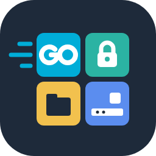

<p align="center"></p>

# go-desktop-kit

[繁體中文](README.md) | **English** | [日本語](README.ja.md)

> The Traditional Chinese README is the authoritative version. If the versions differ, it takes precedence.

[](https://paypal.me/The78ester) [](https://ko-fi.com/the78ester)

💖 If this tool helps you, please consider supporting development via [PayPal](https://paypal.me/The78ester) or [Ko-fi](https://ko-fi.com/the78ester).

Reusable building blocks for Go desktop programs: keep secrets in the operating system's credential store, encrypt files with a passphrase, find each platform's settings folder, and more. These packages **depend on no GUI framework**, so command-line tools, servers and any GUI program can use them.

UI components that depend on [Gio](https://gioui.org) live in a separate repository: [go-gio-kit](https://github.com/The78estHerry/go-gio-kit).

## Packages

| Package | Purpose | Status |
|---|---|---|
| `sealbox` | Passphrase encryption and decryption in the standard [age](https://age-encryption.org) format | v0.1.0 |
| `secretstore` | Secret storage: Windows Credential Manager, macOS Keychain, Linux Secret Service; an age-encrypted file on Linux without a desktop | v0.1.0 |
| `desktop/paths` | Per-platform settings and cache folders | v0.1.0 |
| `tray` | System tray icon and menu (wraps fyne.io/systray; callbacks, PNG icons converted to ICO on Windows) | v0.2.0 |
| `desktop/single` | Run one instance; a second launch asks the first to show itself | v0.2.0 |
| `desktop/autostart` | Start at login (Windows Run key, macOS LaunchAgent, Linux XDG autostart) | v0.2.0 |
| `desktop/i18n` | UI translation: message table (missing text falls back to the default language), picks from the system's preferred languages (tells Traditional and Simplified Chinese apart) | v0.2.0 |
| `desktop/userauth` | OS user verification: Windows Hello (face, fingerprint, PIN), macOS Touch ID or login password; unavailable on Linux | v0.3.0 |
| `desktop/apppin` | An app PIN when the OS cannot verify: only an argon2id hash is stored; 5 wrong attempts lock it (30 seconds, doubling up to one hour), surviving restarts | v0.3.0 |

## Install

```bash
go get github.com/The78estHerry/go-desktop-kit@latest
```

## Example

```go
store, err := secretstore.Open("my-app")
if err != nil {
    log.Fatal(err)
}
// Stored in the OS credential store; on Windows the name is "my-app:gitea-home/token"
if err := store.Set("gitea-home", "token", token); err != nil {
    log.Fatal(err)
}
keys, _ := store.List("gitea-home") // names only: ["token"]

// Seal data into a portable file with a passphrase
var buf bytes.Buffer
if err := sealbox.Seal(&buf, data, passphrase); err != nil {
    log.Fatal(err)
}
```

## Security design

- **No API prints or exports secrets**: `List` returns names only; the caller decides what to do with a value.
- **No home-made cryptography**: the credential store is the OS's own, and every encrypted file uses age.
- **Passphrases are never stored**: a lost `sealbox` passphrase cannot be recovered, by design.
- **Any Unicode passphrase works**: passphrases are NFC-normalized first, so the same phrase typed on Windows, macOS and Linux gives the same result.
- **Standard format**: a `sealbox` file is an age file, so the official `age -d` can open it even if this package disappears.

## Platform support

Only Windows is tested on real hardware so far. GitHub Actions builds macOS and Linux and runs the unit tests, but the real credential store behavior there has not been verified on hardware yet. Reports are welcome.

| Package | Windows | macOS | Linux |
|---|---|---|---|
| `sealbox`, `desktop/paths` | Tested on hardware | Verified in CI | Verified in CI |
| `secretstore` | Tested on hardware | Implemented, not tested | Implemented, not tested |
| `desktop/single`, `desktop/autostart`, `desktop/i18n` | Tested on hardware | Tested in CI, not on hardware | Tested in CI, not on hardware |
| `tray` | Tested on hardware | Implemented, not tested | Implemented, not tested |
| `desktop/userauth` | Tested on hardware | Implemented, not tested | Unsupported (use the app PIN) |
| `desktop/apppin` | Tested on hardware | Tested in CI | Tested in CI |

## License

[MIT](LICENSE). This software is provided as is, without warranty of any kind; the author is not liable for any damage caused by using it.

If this tool helps you, sponsorship to support development is welcome via [PayPal](https://paypal.me/The78ester) or [Ko-fi](https://ko-fi.com/the78ester).
