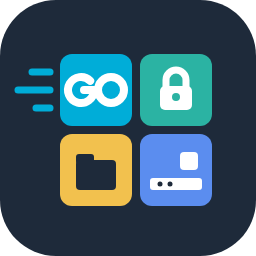

<p align="center"></p>

# go-desktop-kit

[繁體中文](README.md) | [English](README.en.md) | **日本語**

> 繁体字中国語版の README が正式版です。内容が異なる場合は繁体字中国語版を優先してください。

[](https://paypal.me/The78ester) [](https://ko-fi.com/the78ester)

💖 このツールが役に立った場合は、[PayPal](https://paypal.me/The78ester) または [Ko-fi](https://ko-fi.com/the78ester) から開発を支援していただけるとうれしいです。

Go のデスクトッププログラム向けの再利用可能な基礎パッケージです。機密情報を OS の資格情報ストアに保存する、パスワードでファイルを暗号化する、各プラットフォームの設定フォルダーを見つける、などができます。これらのパッケージは **GUI フレームワークに依存しない** ため、コマンドラインツール、サーバー、どの GUI プログラムからも使えます。

[Gio](https://gioui.org) に依存する UI 部品は別のリポジトリ [go-gio-kit](https://github.com/The78estHerry/go-gio-kit) にあります。

## パッケージ

| パッケージ | 用途 | 状態 |
|---|---|---|
| `sealbox` | パスワードによる暗号化と復号。標準の [age](https://age-encryption.org) 形式で出力 | v0.1.0 |
| `secretstore` | 機密情報の保管：Windows 資格情報マネージャー、macOS キーチェーン、Linux Secret Service。デスクトップのない Linux では age で暗号化したファイル | v0.1.0 |
| `desktop/paths` | 各プラットフォームの設定フォルダーとキャッシュフォルダー | v0.1.0 |
| `tray` | システムトレイのアイコンとメニュー | 予定 |
| `desktop/single` | 1 つだけ起動。2 つ目の起動時は 1 つ目に表示を依頼 | 開発中（main） |
| `desktop/autostart` | ログイン時の起動（Windows の Run キー、macOS の LaunchAgent、Linux の XDG autostart） | 開発中（main） |
| `desktop/i18n` | UI の言語 | 予定 |
| `desktop/userauth`、`desktop/apppin` | OS の本人確認（Windows Hello など）と、使えない場合のアプリ PIN | 予定 |

## インストール

```bash
go get github.com/The78estHerry/go-desktop-kit@latest
```

## 使用例

```go
store, err := secretstore.Open("my-app")
if err != nil {
    log.Fatal(err)
}
// OS の資格情報ストアに保存。Windows での名前は "my-app:gitea-home/token"
if err := store.Set("gitea-home", "token", token); err != nil {
    log.Fatal(err)
}
keys, _ := store.List("gitea-home") // 名前だけを返す：["token"]

// パスワードでデータを持ち運べるファイルに封じる
var buf bytes.Buffer
if err := sealbox.Seal(&buf, data, passphrase); err != nil {
    log.Fatal(err)
}
```

## セキュリティ設計

- **機密情報を表示・エクスポートする API はない**：`List` は名前だけを返す。値をどう扱うかは呼び出し側が決める。
- **暗号処理を自作しない**：保管には OS の仕組みを使い、暗号化ファイルはすべて age を使う。
- **パスワードはどこにも保存しない**：`sealbox` のパスワードを忘れると復号できない。これは意図した設計。
- **パスワードには任意の Unicode を使える**：暗号化の前に NFC 正規化するため、同じパスワードを Windows、macOS、Linux で入力しても結果は同じ。
- **標準形式**：`sealbox` のファイルは age ファイルそのものなので、このパッケージがなくなっても公式の `age -d` で開ける。

## 対応プラットフォーム

現在、実機でテストしているのは Windows だけです。macOS と Linux は GitHub Actions でビルドと単体テストを行っていますが、資格情報ストアの実際の動作はまだ実機で確認していません。結果の報告を歓迎します。

| パッケージ | Windows | macOS | Linux |
|---|---|---|---|
| `sealbox`、`desktop/paths` | 実機テスト済み | CI で確認 | CI で確認 |
| `secretstore` | 実機テスト済み | 実装済み・未テスト | 実装済み・未テスト |
| `desktop/single`、`desktop/autostart` | 実機テスト済み | CI でテスト、実機は未テスト | CI でテスト、実機は未テスト |

## ライセンス

[MIT](LICENSE)。本ソフトウェアは現状のまま提供され、いかなる保証もありません。使用によって生じたいかなる損害についても、作者は責任を負いません。

このツールが役に立った場合は、開発への支援（スポンサー）を歓迎します：[PayPal](https://paypal.me/The78ester) または [Ko-fi](https://ko-fi.com/the78ester)。
