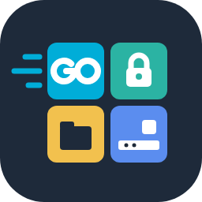

<p align="center"></p>

# go-desktop-kit

**繁體中文** | [English](README.en.md) | [日本語](README.ja.md)

[](https://paypal.me/The78ester) [](https://ko-fi.com/the78ester)

💖 如果這個工具對你有幫助，歡迎透過 [PayPal](https://paypal.me/The78ester) 或 [Ko-fi](https://ko-fi.com/the78ester) 贊助支持開發。

Go 桌面程式的可重用基礎套件：把機密存進作業系統的保管庫、用密碼加密檔案、找到各平台的設定資料夾等等。這些套件**不依賴任何 GUI 框架**，命令列工具、伺服器程式和任何 GUI 程式都能使用。

依賴 [Gio](https://gioui.org) 的介面元件放在另一個 repo：[go-gio-kit](https://github.com/The78estHerry/go-gio-kit)。

## 套件

| 套件 | 用途 | 狀態 |
|---|---|---|
| `sealbox` | 用密碼加密與解密，輸出標準 [age](https://age-encryption.org) 格式 | v0.1.0 |
| `secretstore` | 機密保管庫：Windows Credential Manager、macOS Keychain、Linux Secret Service；沒有桌面的 Linux 改用 age 加密檔 | v0.1.0 |
| `desktop/paths` | 各平台的設定與快取資料夾 | v0.1.0 |
| `tray` | 系統列圖示與選單（包裝 fyne.io/systray；用 callback、PNG 圖示，Windows 自動轉 ICO） | 開發中（main） |
| `desktop/single` | 只執行一份；第二份啟動時請第一份顯示出來 | 開發中（main） |
| `desktop/autostart` | 登入時啟動（Windows Run 機碼、macOS LaunchAgent、Linux XDG autostart） | 開發中（main） |
| `desktop/i18n` | 介面翻譯：訊息表（缺字退回預設語言）、依系統偏好語言挑選（分辨繁簡中文） | 開發中（main） |
| `desktop/userauth`、`desktop/apppin` | 作業系統本人驗證（Windows Hello 等），以及不可用時的 App PIN | 規劃中 |

## 安裝

```bash
go get github.com/The78estHerry/go-desktop-kit@latest
```

## 使用範例

```go
store, err := secretstore.Open("my-app")
if err != nil {
    log.Fatal(err)
}
// 存進作業系統保管庫；Windows 上的名稱是 "my-app:gitea-home/token"
if err := store.Set("gitea-home", "token", token); err != nil {
    log.Fatal(err)
}
keys, _ := store.List("gitea-home") // 只回傳名稱：["token"]

// 用密碼把資料封裝成可攜帶的檔案
var buf bytes.Buffer
if err := sealbox.Seal(&buf, data, passphrase); err != nil {
    log.Fatal(err)
}
```

## 安全設計

- **沒有任何會印出或匯出機密的 API**：`List` 只回傳名稱；拿到值之後怎麼處理由呼叫端決定。
- **不自己寫加密**：保管庫用作業系統的機制，加密檔一律用 age。
- **密碼不儲存在任何地方**：`sealbox` 的密碼遺失就無法解開，這是刻意的設計。
- **密碼可以用任何 Unicode**：加密前先做 NFC 正規化，同一句密碼在 Windows、macOS、Linux 上輸入的結果一致。
- **標準格式**：`sealbox` 產生的檔案就是 age 檔，就算這個套件不在了，也能用官方的 `age -d` 解開。

## 平台支援

目前只在 Windows 上實機測試；macOS 與 Linux 由 GitHub Actions 編譯並執行單元測試，系統保管庫的實際行為還沒有實機驗證，歡迎回報結果。

| 套件 | Windows | macOS | Linux |
|---|---|---|---|
| `sealbox`、`desktop/paths` | 實機測試 | CI 驗證 | CI 驗證 |
| `secretstore` | 實機測試 | 已實作、未測試 | 已實作、未測試 |
| `desktop/single`、`desktop/autostart`、`desktop/i18n` | 實機測試 | CI 測試、未實機測試 | CI 測試、未實機測試 |
| `tray` | 實機測試 | 已實作、未測試 | 已實作、未測試 |

## 授權

[MIT](LICENSE)。本軟體依現狀提供，不提供任何保證；使用造成的任何損害，作者不負責任。

如果這個工具對你有幫助，歡迎透過 [PayPal](https://paypal.me/The78ester) 或 [Ko-fi](https://ko-fi.com/the78ester) 贊助支持開發。
